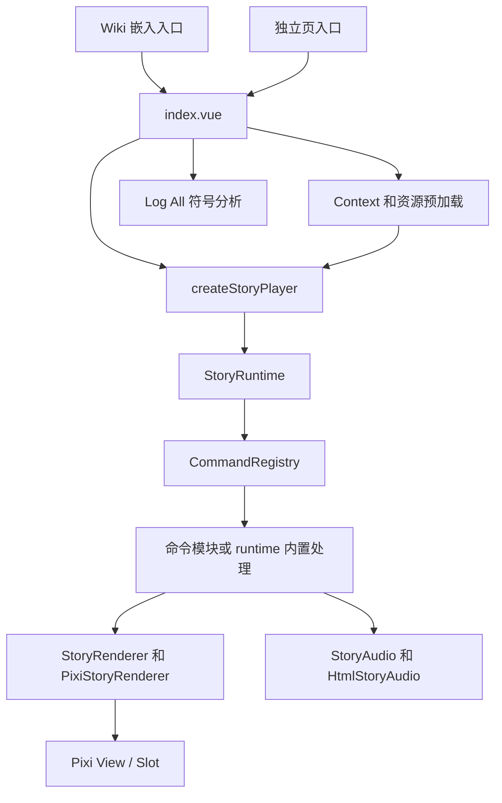

# StoryPlayer 架构与 Native 对照

StoryPlayer 在浏览器中执行明日方舟的 AVG 剧情脚本。`StoryRuntime` 持有命令游标、等待状态和播放模式，命令模块负责参数与命令生命周期，`PixiStoryRenderer` 组装画面，`HtmlStoryAudio` 管理音频。Native 一列默认使用客户端 PC 2.7.91（build 2791）的 `Torappu.AVG` 符号，Web 对照以 `prts-widgets` 的 `49a6771` 为基线。表中的对应关系按职责建立，适用范围为普通 AVG 播放路径。

## 入口与分层

- **入口。** Wiki 从 `#datas_txt` 取文本。独立页由 `loadPageStory()` 读取 `url` 或 `path` 并获取文本，再传给同一个 Vue 组件。`index.vue` 负责大厅、文本全览、播放 HUD 和全屏。 [Wiki 入口](../../entries/widgets/StoryPlayer.ts) · [独立页](../../pages/StoryPlayer.vue) · [独立页取数](../../pages/story.ts) · [Vue 外壳](index.vue)
- **准备。** `loadContextByScript()` 解析 `HEADER`，从 `avg/metadata.json` 读取剧情变量与逐图 PPU（每单位像素数），并行加载角色映射和探测缺失视频。前景和背景按 `纹理尺寸 × 100 / PPU` 计算原生尺寸。外壳并行预加载资源和准备播放器，对话字体在 Pixi `mount()` 前就绪。 [上下文](context.ts) · [预加载](engine/preload.ts) · [字体](engine/font.ts)
- **运行。** `createStoryPlayer()` 组装运行时、渲染和音频，实现对外 `StoryPlayer` 接口。命令模块通过 `StoryRenderer` 和 `StoryAudio` 接口调用后端，视图持有容器、贴图、动画和槽位。 [播放器入口](engine/createStoryPlayer.ts) · [公共接口](engine/types.ts) · [渲染器](engine/rendering/PixiStoryRenderer.ts) · [音频](engine/audio.ts)

## 核心类与方法

| Native 类与方法                                                                                                                                                              | Web 类与方法                                                                                                                                     | 职责与适配                                                                                                                                                                                                                                               |
| ---------------------------------------------------------------------------------------------------------------------------------------------------------------------------- | ------------------------------------------------------------------------------------------------------------------------------------------------ | -------------------------------------------------------------------------------------------------------------------------------------------------------------------------------------------------------------------------------------------------------- |
| `AVG.PerformanceStoryMiddleware._LoadStoryText`、`ResourceRouter.GetStoryPath`、`AVG._StartStoryInternalByString`                                                            | `loadPageStory()` / Wiki 入口 → `loadContextByScript()` → `createStoryPlayer()`                                                                  | Native 从资源系统取得 `TextAsset`，Web 入口取得字符串后组装播放上下文。 [独立页取数](../../pages/story.ts) · [Wiki 入口](../../entries/widgets/StoryPlayer.ts) · [上下文](context.ts) · [播放器入口](engine/createStoryPlayer.ts)                        |
| `AVGParser._ReadNextBlock`、`_ParseCommand`、两层 `TryParse`                                                                                                                 | `logicalLines()`、`parseLine()`、`parseScript()` / `parseStory()`                                                                                | 处理续行与注释、识别命令和参数、补 `endtip`，从首条 `HEADER` 提取 `StoryMetadata`。逻辑块用首个物理行的 1-based 行号。命令名折叠为小写，参数键保留大小写。 [解析器](engine/parser.ts)                                                                    |
| `Story` 与 `Command`                                                                                                                                                         | `parseStory()` 返回的 `StoryMetadata` 和 `ParsedLine[]`                                                                                          | `Command.param` 对应命令行的 `args`。Web 把常用发言人标签和纯旁白保留为独立行类型，在运行时汇入对话执行器。 [类型](engine/types.ts) · [解析器](engine/parser.ts)                                                                                         |
| `Command.TryGetParam` / `GetOrDefault<T>`                                                                                                                                    | `commandParams.ts` 的 `exactArg()`、`getBool()`、`getFiniteFloat()`、`convertStoryParameter()` 等                                                | 参数取值、变量解析和类型转换由各命令按需调用。 [参数工具](engine/commandParams.ts)                                                                                                                                                                       |
| `AVGController._InitExecutors`、`_GetCommandExecutors`、`_ExecuteExecutor`                                                                                                   | `StoryRuntime` 构造函数、`CommandRegistry.register()` / `get()`、`StoryRuntime.executeCommand()`                                                 | Native 从场景组件收集执行器。Web 显式构造并注册。一个命令名可有多个执行器，运行时汇总它们返回的等待。 [注册表](engine/commandRegistry.ts) · [运行时](engine/runtime.ts)                                                                                  |
| `AVGController.RunStory`、`OnStoryBegin`、`DoExecuteCommands`                                                                                                                | `StoryRuntime.start()`、`processLoop()`                                                                                                          | 初始化同故事事件订阅，消费 `warp` 目标，对当前行判定 `predicate`，派发命令并推进游标。同步执行器可在同一轮推进到下一次等待。 [运行时](engine/runtime.ts)                                                                                                 |
| `ExecutorComponent.GetExecutors` / `Execute` / `FinishCommand` / `OnFinish`、`CommandExecutorWrapper` 的完成和强制结束                                                       | `ExecutorComponent.getExecutors()` / `register()` / `execute()` / `finishCommand()` / `onFinish()` / `forceCommandEnd()`，以及 `ExecutionHandle` | 每个命令面板有一个共享完成槽。Web 面板把阻塞动画包装为 `WaitForFrame`，运行时负责轮询和中断。`ExecutionHandle` 让轮询同步读取结束原因，同时供异步调用者等待。 [命令面板基类](engine/ExecutorComponent.ts) · [执行句柄](engine/execution.ts)              |
| `AVGController.OnClickPress`、`DoAutoClick`、`eventPool` 的 `ON_CLICK` / `ON_SPEED_SET`                                                                                      | `StoryRuntime.advance()` / `advanceFromClick()` / `setAutoPlaySpeedLevel()`、`EventPool<AVGEvent>`                                               | 手动点击和自动点击共用 `advanceFromClick()` 发布 `Click`。速度事件供对话、字幕和贴纸更新打字速度。决策选项通过 Pixi 点击归属判断消费点击。 [运行时](engine/runtime.ts) · [事件池](engine/eventPool.ts) · [点击归属](engine/rendering/core/ClickClaim.ts) |
| `DialogPanel._OnTypeWriterEnd`、`AVGController.RaiseAutoClick`、`DoAutoClick`、`AVGUtils.CalculateFadetime`                                                                  | `StoryRuntime.onTypingComplete()` / `scheduleAutoClick()` / `pollAfterUpdate()` / `calculateFadeMs()`                                            | 打字完成后建立自动点击状态，按帧依次等自动模式、真实时间和再次确认模式。动画速度倍率与自动点击延迟分别计算，是否缩放时长由各命令确定。 [运行时](engine/runtime.ts)                                                                                       |
| `DecisionCommandPredicator.NeedToExecuteCommand`、`AVGController.OnDecisionSelected`                                                                                         | `DecisionCommandPredicator.needToExecuteCommand()` / `applySelection()`，`StoryRuntime.waitForDecision()`                                        | `DecisionPanel` 写入选项值和引用集合，后续命令先经谓词闸门。选项回调先记选择，帧末确认完成。 [谓词](engine/DecisionCommandPredicator.ts) · [决策面板](engine/panels/DecisionPanel.ts) · [运行时](engine/runtime.ts)                                      |
| `AVGGotoLabel._ExecuteLabel` / `_ExecuteGoto`、`AVGGotoLabel.GotoLabelController.PreprocessCommands` / `GotoCommandIndex`                                                    | `GotoLabelController` 构造函数、`getExecutors()` / `consumeGotoIndex()`                                                                          | 预建标签索引。`label` 放行，`warp` 指定标签后一条命令的索引，运行时在下次取命令前消费一次。 [标签控制器](engine/GotoLabelController.ts)                                                                                                                  |
| `AVGController._PreprocessCommands`、`AVGSkipLabel._ExecuteSkipNode`、`AVGSkipLabel.SkipLabelController.PreprocessCommands`、`AVGStoryCache.AddSkipNode` / `GetNextSkipNode` | `StoryRuntime` 构造函数扫描首个 `skiptothis`，`SkipLabelController` 构建、消费 `skipnode` 队列                                                   | `skiptothis` 是单独的向前跳转锚点。`skipnode` 消费队列并切换段落的 `skip` / `nofirstskip` 模式。 [运行时](engine/runtime.ts) · [跳段控制器](engine/SkipLabelController.ts)                                                                               |
| `AVGController.get_isSkippable`、`OnSkipBtnClicked`、`SkipStory`、`_ResetComponentsOnSkip`、组件的 `ShouldResetOnSkip`                                                       | `StoryRuntime.canSkipNode()` / `skipNode()` / `resumeSkipOnFrame()`、各面板的 `reset()`                                                          | Web 跳段入口要求脚本有可用锚点。跳到后续段落时清理过场、咒文贴纸、字幕和普通贴纸，保留已挂载的立绘与 CG 等状态，并处理浏览器侧尚未完成的资源准备。 [运行时](engine/runtime.ts)                                                                           |
| `AVGTheaterLabel._ExecuteTheaterNode`、`AVGController._SetTheaterModeStatus` / `_SaveAutoStatus` / `_LoadAutoStatus`                                                         | `TheaterLabel.getExecutors()` / `setTheaterMode()`、`StoryRuntime.applyScriptAutoPlayMode()`                                                     | 进入剧场后接管自动档位，退出时恢复。Vue 依据 `isTheaterMode()` 控制 HUD，运行时忽略剧场内的手动推进。 [剧场命令](engine/panels/TheaterLabel.ts) · [运行时](engine/runtime.ts) · [Vue 外壳](index.vue)                                                    |
| `AVGController.OnStoryCommitted` / `OnStoryEnd`                                                                                                                              | `StoryRuntime.finishPlayback()`、`StoryPlayer.closeAfterStory()`                                                                                 | 剧情结束会清理订阅、等待和各面板。Web 正常关闭释放场景后允许收尾音效淡出，`destroy()` 则立即销毁音频。 [运行时](engine/runtime.ts) · [播放器入口](engine/createStoryPlayer.ts) · [音频](engine/audio.ts)                                                 |

## 命令参数解析

`parseLine()` 把脚本文本解析为 `ParsedCommandLine.args`，值保留为字符串、数字、布尔值或 `null`。命令执行器按 Native 的取值方式选用 helper，并在调用处应用各命令自己的默认值与单位。尤其要区分键缺失、显式 `null` 和非法值，例如 `getFiniteFloat(args, "width") ?? 1` 遇到缺失键取 `1`，遇到 `width=null` 得到 `0`。 [解析器](engine/parser.ts) · [参数 helper](engine/commandParams.ts) · [前景图用例](../../../tests/story-player/runtime/background.spec.ts)

| 用途               | Web helper                                                                                   | Native 对应与返回约定                                                                                                                                                                                                                                                                                                  |
| ------------------ | -------------------------------------------------------------------------------------------- | ---------------------------------------------------------------------------------------------------------------------------------------------------------------------------------------------------------------------------------------------------------------------------------------------------------------------- |
| 按原键名取值       | `exactArg(args, key)`                                                                        | 对应 `Command.TryGetParam` 的字典查找。只读同名自有属性，例如 `xScale` 和 `xscale` 分别查找。缺失返回 `undefined`，显式 `null` 原样保留。                                                                                                                                                                              |
| 展开参数变量       | `convertStoryParameter(value, variables, keyMatch)`                                          | 对应 `AVGVariableConfig.Convert`。参数值以 `$` 开头时查表，找不到时保留原值。`"exact"` 对应 Native 区分大小写的变量字典，标签和剧场使用此模式。默认的 `"folded"` 服务于 Web 已有的音频变量别名。                                                                                                                       |
| 读取有限浮点数     | `getFiniteFloat(args, key, variables?)`                                                      | 对应 `GetFloat` / `Command.TryGetParam<float>` 经 `Convert.ToSingle` 的输入语义，接受指数、分组逗号，布尔值与 `null` 分别按 `1` / `0` 与 `0` 读取。检查 `Single` 的有限范围，返回值保留 JS 精度。缺失、非法或非有限值返回 `undefined`，由调用处用 `??` 兜底。                                                          |
| 转换已取出的数值   | `tryConvertToSingle(value)`、`toOptionalNumber(value)`、`toNumber(value, fallback)`          | `tryConvertToSingle()` 对应 `Convert.ToSingle`，得到单精度值，保留 `NaN` / `Infinity` 字面量的转换结果，转换失败返回 `null`。`toOptionalNumber()` 是较窄的 Web 读法，接受有限数字、布尔值和十进制数字字符串（含指数），显式 `null` 或带分组逗号的字符串返回 `undefined`。`toNumber()` 给这条读法加默认值，默认为 `0`。 |
| 读取整数           | `tryConvertToInt32(value)`、`tryParseInt32(text)`                                            | 前者对应 `Convert.ToInt32`，数字恰在中点时舍入到偶数，布尔值转换为 `1` / `0`，显式 `null` 转换为 `0`。字符串走后者，按 `Int32.TryParse` 读取带可选正负号的十进制整数。非法或超出 `Int32` 范围返回 `null`。                                                                                                             |
| 读取布尔值         | `getBool(args, key, variables?)`、`tryConvertToBoolean(value)`、`toBoolean(value, fallback)` | `getBool()` 对应 `GetBool` / `Command.TryGetParam<bool>`，可先展开变量，缺失或非法时取 `false`。底层 `tryConvertToBoolean()` 保留缺失或非法的 `undefined`，数值按是否非零判断，字符串按 `true` / `false` 忽略大小写转换。`toBoolean()` 接受布尔值或精确小写字符串，其余取调用方默认值。                                |
| 字符串化           | `boxedParamString(value)`、`toString(value, fallback)`                                       | `boxedParamString()` 对应 `DotNetExtensionMethods.GetString` 中的 `Convert.ToString`，布尔值输出 `True` / `False`。`toString()` 对布尔值使用 JS 的 `true` / `false`，空值走默认值，默认为空字符串。                                                                                                                    |
| 读取枚举           | `tryParseEnum(raw, members, ignoreCase?)`                                                    | 对应 `GetEnum<T>` 使用的 `Enum.TryParse` 路径，接受枚举名和 `Int32` 数值，默认区分大小写。合法的数值可没有对应成员，转换失败返回 `null`。`HEADER` 在调用处启用忽略大小写并应用各字段的默认值。                                                                                                                         |
| 比较浮点时长和阈值 | `hasTweenDuration(seconds)`、`isZeroFloat(value)`、`isNonNegativeFloat(value)`               | 分别对应 Native `MathUtil.LE(seconds, 0)` 的反向判断、`IsZero`、`GE(value, 0)`。用单精度和约 `1e-5` 的容差判断。时长是否乘 `animateRatio` 由执行器决定，例如 `image` 的淡变缩放，`imagetween` 的 `duration` 直接由秒转毫秒。                                                                                           |

`getFiniteFloat()` 和 `getBool()` 只在传入变量表时展开 `$变量`，正文里的 `{@变量}` 走另一个入口 `expandStoryText()`，对应 `AVGTextManager.Translate` 的文本用途。对失败有特殊要求的命令保留自己的分支，例如 `StickerPanel` 的 `readTimerParam()` 对缺失参数返回 `undefined`，对存在但转换失败的参数抛错，以对应计时贴纸的 `Command.TryGetParam` 行为。 [文本变量](engine/textVariables.ts) · [计时参数](engine/panels/StickerPanel.ts)

### 命令族共用的 helper

| 参数               | Web helper                                                                                                                                  | 使用位置与对应关系                                                                                                                                                                                                                                                                                                                            |
| ------------------ | ------------------------------------------------------------------------------------------------------------------------------------------- | --------------------------------------------------------------------------------------------------------------------------------------------------------------------------------------------------------------------------------------------------------------------------------------------------------------------------------------------- |
| 图像布局和补间     | `parseImageLayout()`、`parseImageTween()`                                                                                                   | 对应 `AVGImagePanel._LoadImage` 和 `_ExecuteImageTween`，前景图与普通背景共用。布局缺失时，尺寸和缩放默认 `1`，位置默认 `0`。补间的缺失端点保留为 `undefined`，由视图取当时的变换。 [图像参数](engine/imageParams.ts)                                                                                                                         |
| 大背景拼图         | `resolvePuzzleAssets()`、`parsePuzzleTween()`、`LargeBackgroundPanel` 文件内的 `scalarDimension()` / `tileDimensions()`                     | `resolvePuzzleAssets()` 对应 `_TryExtractCGParam`，优先取非空 `imagegroup`，否则取 `cggroup`。尺寸按 Native 布局读取单值或斜杠分隔列表。`parsePuzzleTween()` 处理 `_ExecuteImageTween` 的字面时长和变换。 [拼图参数](engine/puzzleCommands.ts) · [拼图命令](engine/panels/LargeBackgroundPanel.ts)                                            |
| 立绘引用和动作整数 | `parseNativeCharacterRef()`、`resolveCharacterRef()` / `resolveNativeCharacterRef()`、`nativeCharacterFadeIdentity()`、`toNativeIntParam()` | 前三组对应 `AVGCharacterSlot._LoadImage` 的后缀处理、贴图查找和 `_GetIdWithoutAliasOrIndex` 的淡变身份。`toNativeIntParam()` 用在立绘动作的 `times`、`random` 等参数，读取默认值并进行中点舍入，也把小写字符串 `"true"` / `"false"` 转为 `1` / `0`。 [立绘引用](engine/characterRef.ts) · [动作参数](engine/panels/characterCommandParams.ts) |
| 二维坐标和贴纸对齐 | `parseVector2()`、`parseSubtitleAlignment()`                                                                                                | `parseVector2()` 读取逗号分隔字符串的前两项，用于 `stickertween` 的 `pfrom` / `pto`。`parseSubtitleAlignment()` 把贴纸对齐值归一为 `left` / `center` / `right`，缺失或无法识别时由调用处取 `left`。 [参数 helper](engine/commandParams.ts) · [贴纸命令](engine/panels/StickerPanel.ts)                                                        |
| 选项和值列表       | `parseDecision()`、`parsePredicateReferences()`                                                                                             | 对应 `DecisionPanel._ExecuteDecision` / `_ExecutePredicate` 与 `_GetOptionValue`。按分号拆分，整数转换失败的项取 `0`，缺失的 `references` 返回 `null`。运行时和 Log All 共用。 [分支参数](engine/log/semantics.ts)                                                                                                                            |
| 视频来源           | `getStoryVideoSource()`                                                                                                                     | 对应 `AVGVideoPanel._PlayVideo` 的键存在性分支。`url` 存在时优先，即使其值为空，只有缺失时才查 `res`。视频执行和缺失资源探测共用。 [资源参数](engine/asset.ts) · [视频命令](engine/panels/VideoPanel.ts) · [资源探测](context.ts)                                                                                                             |

## 按剧情命令查找实现

Web 命令列中的方法通常在 `getExecutors()` 里绑定。同名类可能分处 `engine/panels/` 和 `engine/rendering/panels/`，前者负责命令，后者负责对象和动画。

| 剧情命令                                                                         | Native 执行器                                                                                                                                                                                                         | Web 命令模块                                                                                                                                                                                         | Web 呈现                                                                                                                                                                                                                                                                                                      |
| -------------------------------------------------------------------------------- | --------------------------------------------------------------------------------------------------------------------------------------------------------------------------------------------------------------------- | ---------------------------------------------------------------------------------------------------------------------------------------------------------------------------------------------------- | ------------------------------------------------------------------------------------------------------------------------------------------------------------------------------------------------------------------------------------------------------------------------------------------------------------- |
| `dialog`、`aside`、`multiline`、`endtip`                                         | `DialogPanel._ExecuteDialog` / `_ExecuteAside` / `_ExecuteMultiline` / `_ExecuteEndtip`                                                                                                                               | `DialogPanel.executeDialog()`（含 `aside`）/ `executeMultiline()` / `executeEndtip()`。`[name="…"]` 和旁白由 `executeTextLine()` 转入同一个 `executeDialog()`。 [命令](engine/panels/DialogPanel.ts) | `PixiStoryRenderer.setDialogue()` → `DialogView.setDialogue()`。 [视图](engine/rendering/panels/DialogView.ts)                                                                                                                                                                                                |
| 对话与字幕的打字机                                                               | `AVGTypeWriterText.BeginText` / `AppendText`                                                                                                                                                                          | `AVGTypeWriterText.beginText()`，通过 `startIndex` 接续，`tryFinish()` 补全。 [打字机](engine/panels/AVGTypeWriterText.ts)                                                                           | 面板把可见字符和布局传给对应视图。                                                                                                                                                                                                                                                                            |
| `subtitle`                                                                       | `SubtitlePanel._ExecuteSubtitle`                                                                                                                                                                                      | `SubtitlePanel.executeSubtitle()`。 [命令](engine/panels/SubtitlePanel.ts)                                                                                                                           | `PixiStoryRenderer.setSubtitle()` → `SubtitleView`。 [视图](engine/rendering/panels/SubtitleView.ts)                                                                                                                                                                                                          |
| `decision`、`predicate`                                                          | `DecisionPanel._ExecuteDecision` / `_ExecutePredicate`                                                                                                                                                                | `DecisionPanel.executeDecision()` / `getExecutors().predicate`。 [命令](engine/panels/DecisionPanel.ts)                                                                                              | `PixiStoryRenderer.showDecision()` → `DecisionView.show()`，只更新闸门的 `predicate` 直接放行。 [视图](engine/rendering/panels/DecisionView.ts)                                                                                                                                                               |
| `sticker`、`stickerclear`、`stickertween`、`timersticker`、`timerclear`          | `StickerPanel._ExecuteSticker` / `_ExcuteClear` / `_ExecuteStickerTween` / `_ExcuteTimerSticker` / `_ExcuteTimerClier`                                                                                                | `StickerPanel.executeSticker()` 按命令分支。 [命令](engine/panels/StickerPanel.ts)                                                                                                                   | `StickerView` 管贴纸，Native `AVGTimerView` 对应 `TimerView`。 [贴纸视图](engine/rendering/panels/StickerView.ts) · [计时视图](engine/rendering/panels/TimerView.ts)                                                                                                                                          |
| `spellsticker`、`spellstickerclear`                                              | `AVGSpellStickerPanel._ExecuteSpellSticker` / `_ExecuteSpellStickerClear`                                                                                                                                             | `SpellStickerPanel.executeSticker()` / `executeClear()`。 [命令](engine/panels/SpellStickerPanel.ts)                                                                                                 | `PixiStoryRenderer.setSpellSticker()` → 渲染侧 `SpellStickerPanel`。 [视图](engine/rendering/panels/SpellStickerPanel.ts)                                                                                                                                                                                     |
| `character`、`characteraction`、`charslot`                                       | `CharacterPanel._ExecuteCharacter` / `_ExecuteCharacterAction`、`AVGCharacterslotPanel._ExecuteCharslot`                                                                                                              | `CharacterPanel.show()` / `act()`、`CharacterslotPanel.update()`。两个模块各自注册。 [基础立绘命令](engine/panels/CharacterPanel.ts) · [槽位命令](engine/panels/CharacterslotPanel.ts)               | 两者共用 `CharacterView`，通过 `CharacterSlotView` 管理对应 Native `AVGCharacterSlot` 的显示对象。`CharacterArtLoader` 处理立绘和表情贴图。 [视图](engine/rendering/panels/CharacterView.ts) · [槽位](engine/rendering/characters/CharacterSlotView.ts) · [图像](engine/rendering/characters/CharacterArt.ts) |
| `image`、`imagetween`、`imagerotate`                                             | `AVGImagePanel._ExecuteImage` / `_ExecuteImageTween` / `_ExecuteImageRotate`                                                                                                                                          | `ImagePanel.show()` / `move()` / `rotate()`。 [命令](engine/panels/ImagePanel.ts)                                                                                                                    | `ImageView.show()` / `move()` / `rotate()`，管理前景双槽、变换和完成回调。 [视图](engine/rendering/panels/ImageView.ts)                                                                                                                                                                                       |
| `background`、`backgroundtween`                                                  | `BackgroundPanel.GetExecutors` 绑定继承的 `AVGImagePanel._ExecuteImage` / `_ExecuteImageTween`                                                                                                                        | `StoryRuntime.executeRenderCommand()` 中的两个分支。 [命令](engine/runtime.ts)                                                                                                                       | `PixiStoryRenderer.setBackground()` / `clearBackground()` / `setBackgroundTween()`，复用 `imageParams.ts` 的参数读取。 [渲染器](engine/rendering/PixiStoryRenderer.ts) · [图像参数](engine/imageParams.ts)                                                                                                    |
| `largebg`、`verticalbg`、`gridbg`、`largebgtween`                                | `LargeBackgroundPanel._ExecuteImage` / `_ExecuteVerticalBG` / `_ExecuteGridBG` / `_ExecuteImageTween`                                                                                                                 | `LargeBackgroundPanel.show()` 按布局分流，`move()` 处理补间。 [命令](engine/panels/LargeBackgroundPanel.ts)                                                                                          | `LargeBackgroundView.show()` / `clear()` / `move()` 管拼图、淡变和贴图准备。 [视图](engine/rendering/panels/LargeBackgroundView.ts)                                                                                                                                                                           |
| `showitem`、`hideitem`                                                           | `AVGShowItemPanel._ExecuteShowItem` / `_ExecuteHideItem`                                                                                                                                                              | `ShowItemPanel.executeShowItem()` / `executeHideItem()`。 [命令](engine/panels/ShowItemPanel.ts)                                                                                                     | `PixiStoryRenderer.createShowItemSlot()` 创建 photo 或 cutin 单槽。 [照片槽](engine/rendering/panels/ShowItemPhotoSlot.ts) · [切入槽](engine/rendering/panels/ShowItemCutinSlot.ts)                                                                                                                           |
| `cgitem`、`hidecgitem`、`cgitemshake`                                            | `AVGCgItemPanel._ExecuteShowCgItem` / `_ExecuteHideCgItem` / `_ExecuteCgItemShake`                                                                                                                                    | `CgItemPanel.executeShowCgItem()` / `executeHideCgItem()` / `executeShakeCgItem()`。 [命令](engine/panels/CgItemPanel.ts)                                                                            | `CgItemView` 管多槽、震动及 PostDisplay 目标。 [视图](engine/rendering/panels/CgItemView.ts)                                                                                                                                                                                                                  |
| `charactercutin`、`interlude`                                                    | `AVGCharacterCutinPanel._ExecuteCharacterCutin` / `_ExecuteInterlude`                                                                                                                                                 | `CharacterCutinPanel.executeCharacterCutin()` / `executeInterlude()`。 [命令](engine/panels/CharacterCutinPanel.ts)                                                                                  | `setCharacterCutin()` → 渲染侧 `CharacterCutinPanel`，`setInterlude()` → `InterludePanel.run()` → `CutinChannel`。 [立绘切入](engine/rendering/panels/CharacterCutinPanel.ts) · [过场](engine/rendering/panels/InterludePanel.ts) · [通道](engine/rendering/panels/CutinChannel.ts)                           |
| `animtext`、`avgdisplay`                                                         | `AVGDisplayableExecutor._ExecuteAnimatedText` / `_ExecuteAVGDisplayable`，`AVGDisplayableManager` 管理通用显示对象                                                                                                    | `DisplayableExecutor.executeAnimText()` / `executeAvgDisplay()`。 [命令](engine/panels/DisplayableExecutor.ts)                                                                                       | `AnimTextPanel` 管印章，`AvgDisplayPanel` 管通用显示对象。 [印章](engine/rendering/panels/AnimTextPanel.ts) · [通用显示](engine/rendering/panels/AvgDisplayPanel.ts)                                                                                                                                          |
| `blocker`、`curtain`                                                             | `AVGBlockerPanel._ExecuteBlocker`、`AVGCurtainPanel._ExecuteCurtain`                                                                                                                                                  | `BlockerPanel.show()`、`CurtainPanel.show()`。 [挡板命令](engine/panels/BlockerPanel.ts) · [幕布命令](engine/panels/CurtainPanel.ts)                                                                 | `BlockerView` 持有遮罩状态，`CurtainView` 管幕布实例和羽化。 [挡板视图](engine/rendering/panels/BlockerView.ts) · [幕布视图](engine/rendering/panels/CurtainView.ts)                                                                                                                                          |
| `cameraeffect`、`camerashake`、`focusout`、`focusparam`                          | `AVGCameraEffect._ExecuteCameraEffect` / `_ExecuteCameraShake` / `_ExecuteFocusout` / `_ExecuteFocusParam`                                                                                                            | `CameraEffectExecutor.executeCameraEffect()` / `executeCameraShake()` / `executeFocusOut()` / `executeFocusParam()`。 [命令](engine/panels/CameraEffectExecutor.ts)                                  | 镜头震动由 `PixiStoryRenderer.shakeCamera()` 写场景变换。滤镜和失焦走 `SceneEffectManager` / `SceneFocusOut`。 [渲染器](engine/rendering/PixiStoryRenderer.ts) · [场景特效](engine/rendering/SceneEffectManager.ts) · [失焦](engine/rendering/SceneFocusOut.ts)                                               |
| `video`                                                                          | `AVGVideoPanel._ExecuteVideo` / `_PlayVideo` / `OnFinish`                                                                                                                                                             | `VideoPanel.executeVideo()` / `play()` / `onFinish()`。 [命令](engine/panels/VideoPanel.ts)                                                                                                          | 渲染侧 `VideoPanel` 管浏览器视频与画面。播放完成由运行时在帧末确认。 [视图](engine/rendering/panels/VideoPanel.ts)                                                                                                                                                                                            |
| `playmusic`、`stopmusic`、`musicvolume`、`playsound`、`stopsound`、`soundvolume` | `CommonExecutors` 的 `_ExecutePlayMusicCommand` / `_ExecuteStopMusicCommand` / `_ExecuteMusicVolumeCommand` / `_ExecutePlaySoundCommand` / `_ExecuteStopSoundCommand` / `_ExecuteSoundVolumeCommand` → `AudioManager` | `AudioExecutors.register()`，由 `playMusic()` / `playSound()` 或对应的内联回调同步派发后放行。 [命令](engine/panels/AudioExecutors.ts)                                                               | `HtmlStoryAudio.playMusic()` / `stopMusic()` / `setMusicVolume()` / `playSound()` / `stopSound()` / `setSoundVolume()` 管通道和淡变。 [音频](engine/audio.ts)                                                                                                                                                 |
| `delay`                                                                          | `CommonExecutors._ExecuteDelayCommand`                                                                                                                                                                                | `StoryRuntime` 直接注册，返回 `WaitForDelay`。首次轮询才建立真实时间截止点。 [运行时](engine/runtime.ts)                                                                                             | —                                                                                                                                                                                                                                                                                                             |
| `gotostage`                                                                      | `AVGGotoStagePanel._ExecuteGotoStage`                                                                                                                                                                                 | `StoryRuntime.executeBuiltinCommand()` 直接放行。关卡 UI 跳转由 Native 游戏宿主提供。 [运行时](engine/runtime.ts)                                                                                    | —                                                                                                                                                                                                                                                                                                             |
| `bgeffect`、`effect`、`imgeffect`                                                | `AVGBattleEffectPanel._ExcuteBgEffect` / `_ExecuteEffect` / `_ExcuteImageEffect`                                                                                                                                      | `bgeffect` / `effect` 发出 `unsupported_command` 后放行，`imgeffect` 走未注册命令路径。 [运行时](engine/runtime.ts)                                                                                  | —                                                                                                                                                                                                                                                                                                             |

`header` 和 `skiptothis` 保留在解析后的命令流中，由元数据解析和跳段预处理读取，执行时直接放行。`label`、`warp`、`skipnode`、`theater` 的方法见上面的核心对照表。 [解析器](engine/parser.ts) · [运行时](engine/runtime.ts)

## 帧时序与阻塞

1. **Update。** `PixiStoryRenderer.onFrameUpdate()` 的 `update` 阶段驱动动画与打字机。`updatePhaseTweenRunner` 承接需要在运行时当帧看到完成状态的补间。 [渲染器](engine/rendering/PixiStoryRenderer.ts) · [TweenRunner](engine/rendering/core/TweenRunner.ts)
2. **绘制前。** `StoryRuntime.pollAfterUpdate()` 检查动画与 `delay` 等待，处理可继续的命令和自动点击。面板返回 `"continue"` 可直接推进，`WaitForFrame` 和 `WaitForDelay` 由运行时轮询，`WaitForClick` 订阅点击，`WaitForDecision` 交由选项回调。浏览器资源准备可通过 `assetsReady` 在帧间触发一次轮询。普通背景仍有通过渲染器 `Promise` 完成的路径。 [运行时](engine/runtime.ts) · [等待类型](engine/commandRegistry.ts)
3. **绘制后。** 结束当前等待的推进点击、选项确认和视频结束通过 `finishAtFrameEnd()` / `onFrameEnd()` 完成。下一帧轮询才据此继续取命令。对话打字中收到点击时，`DialogPanel` 可以只补全文字，并继续等一次点击。 [运行时](engine/runtime.ts) · [渲染器](engine/rendering/PixiStoryRenderer.ts) · [对话命令](engine/panels/DialogPanel.ts)

例如，`[Image(...,block=true)]` 由 `ImagePanel.show()` 计算参数，经 `PixiStoryRenderer.setImage()` 交给 `ImageView.show()`。有阻塞动画时，`ExecutorComponent` 把动画句柄包装为帧等待。补间完成回调释放面板完成槽，`StoryRuntime` 在绘制前继续执行。原生路径由 `AVGImagePanel._ExecuteImage` 启动淡变，经 `FinishCommand` 释放控制器的等待。 [前景命令](engine/panels/ImagePanel.ts) · [前景视图](engine/rendering/panels/ImageView.ts) · [命令面板基类](engine/ExecutorComponent.ts)

## 渲染、资源与网页适配

| Native 机制                                                                                        | Web 落点                                                                                                                                                                                                                                                                         |
| -------------------------------------------------------------------------------------------------- | -------------------------------------------------------------------------------------------------------------------------------------------------------------------------------------------------------------------------------------------------------------------------------- |
| Unity `SceneCanvas` / `CgItemCanvas` / `UICanvas`、`AVGCanvasLayerHolder._CalculateNewLayer`       | `LayerGraph` 管 Pixi 容器、相机变换和 `RenderLayer` 排序，`canvasOrderForLayer()` 换算脚本层号。逻辑画布为 1280×720，显示分辨率按宿主和设备像素比调整。 [图层](engine/rendering/core/LayerGraph.ts) · [渲染器](engine/rendering/PixiStoryRenderer.ts)                            |
| DOTween 的 tween、Sequence、Ease                                                                   | `TweenRunner`、`Sequence.insert()` / `append()` / `join()`、`DotweenEase`。视图提供目标、时长和完成回调，运行时观察命令等待。 [补间](engine/rendering/core/TweenRunner.ts) · [时间线](engine/rendering/core/Sequence.ts) · [缓动](engine/rendering/core/DotweenEase.ts)          |
| `AVGSceneEffectManager.UpdateEffect` / `BindPostDisplay`、`AVGSceneFocusOut` 与 `PostDisplayGroup` | `SceneEffectManager` 管全场滤镜及失焦接线，`SceneFocusOut` 保存通道状态和目标绑定。排查物体失焦时，从命令参数沿着视图的绑定追到相应通道。 [特效管理器](engine/rendering/SceneEffectManager.ts) · [失焦](engine/rendering/SceneFocusOut.ts)                                       |
| `ResourceRouter`、各面板的 `IContainsResRefs` / `GatherResRefs`、`AVGAssetLoader`                  | `asset.ts` 把资源键映射到 Web URL，`preloadContextAssets()` 静态扫描剧情并预热 Pixi `Assets`。视图用 `getCachedTexture()` 同步拿已预热的贴图，未命中时再异步加载。 [资源定位](engine/asset.ts) · [预加载](engine/preload.ts) · [贴图缓存](engine/rendering/core/TextureAsset.ts) |

- **Log All。** `buildLogAll()` 调用 `analyzeStoryFlow()` 和 `buildLogDocument()`，为整份脚本生成带分支条件的文本全览。运行时与符号分析共用 `log/semantics.ts` 的谓词和决策解析。`onDisplayedLineChange()` 推送当前显示文本的源行号，选项历史等状态由 Vue 同步。 [Log All](engine/log/index.ts) · [共享语义](engine/log/semantics.ts) · [Vue 外壳](index.vue)
- **跳行。** 点击剧情全文的文本行时，`planChoicesForLine()` 按源行号和所点文本的分支条件规划选项。播放器从头重建，由 `StoryRuntime.seekToLine()` 快进到目标。手动播放在目标文本处等待点击，包括原本会连续播放的贴纸。剧场段由剧场继续自动播放。dev 调试壳按源行号使用同一接口。脚本自身的 `warp` 经 `GotoLabelController` 改命令游标。 [Vue 外壳](index.vue) · [调试壳](components/StoryPlayerDebugShell.vue) · [路径规划](engine/log/seek.ts) · [运行时](engine/runtime.ts)
- **宿主功能。** `fit_mode` 目前解析为 `StoryMetadata.fitMode`，Native `_SetupFitMode()` 的 `CoverCanvas` 属于尚待移植的画面适配。遇到 `is_video_only`，`StoryRuntime.start()` 直接将状态设为 `finished`，游戏的入口视频由其宿主管理。 [元数据](engine/parser.ts) · [运行时](engine/runtime.ts)
